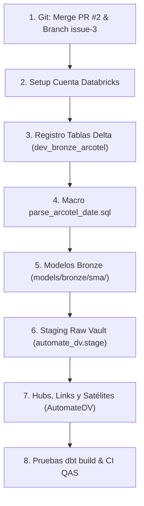

# Bitácora de Estado y Hoja de Ruta — Fase 2: Capa Bronze y Silver Raw Vault (dbt + AutomateDV)

**Rama de Trabajo:** `feat/jhoan/issue-3-dbt-datavault`  
**Issue Asociado:** [#3 — dbt + Data Vault 2.0](https://github.com/jhoandavidpll/ec-telecom-data-platform/issues/3)  
**Fecha de Inicio:** 24 de noviembre de 2026  

---

## 1. Cimientos Consolidados al Iniciar Fase 2

La Fase 1 concluyó exitosamente, dejando los siguientes artefactos 100% operativos:
* **Ingesta Dinámica (`pipelines/arcotel/`):** Scraper, parser de cabeceras jerárquicas multinivel y uploader con particionamiento jerárquico Hive (`year=YYYY/month=MM/day=DD/`) por fecha de ejecución.
* **Datos Históricos Validados:** 3 tablas Parquet generadas en `data/bronze/` con los 208 meses acumulados desde 2008 (`sma_lineas_servicio`, `sma_lineas_modalidad`, `sma_lineas_tecnologia`).
* **Arquitectura dbt en la Raíz:** `dbt_project.yml`, dependencias instaladas (`automate_dv` 0.11.5 y `dbt_utils`), contenedor `Dockerfile` y perfiles en `docker/profiles.yml`.
* **Esquemas Simétricos:** Resolución dinámica configurada en `macros/custom_schema.sql` (`dev_bronze_arcotel`, `qas_bronze_arcotel`, `prd_bronze_arcotel`).
* **Declaración de Fuentes:** `models/sources/sources.yml` configurado para apuntar al catálogo Delta.
* **Automatización:** Workflow mensual en `.github/workflows/monthly_pipeline.yml` y CI con tests unitarios en `.github/workflows/ci_pr.yml`.

---

## 2. Hoja de Ruta y Tareas Pendientes (Fase 2)



---

### Paso 1: Flujo Git para Inicializar la Fase 2
- [ ] Completar el **Merge del Pull Request #2** en GitHub hacia `main`.
- [ ] En la terminal local, actualizar la rama principal y crear la rama de trabajo:
  ```bash
  git checkout main
  git pull origin main
  git checkout -b feat/jhoan/issue-3-dbt-datavault
  ```

---

### Paso 2: Aprovisionamiento y Conexión de Databricks
- [ ] Crear cuenta en Databricks (Free Trial en AWS/Azure o Community Edition).
- [ ] Obtener y configurar en `.env`:
  ```env
  DATABRICKS_HOST=https://<tu-instancia>.cloud.databricks.com
  DATABRICKS_HTTP_PATH=/sql/1.0/endpoints/<endpoint-id>
  DATABRICKS_TOKEN=dapi<tu-token-de-acceso>
  ENV=dev
  ```
- [ ] Validar conectividad dbt:
  ```bash
  dbt debug --profiles-dir docker --target dev
  ```

---

### Paso 3: Registro de Tablas Delta en Databricks
- [ ] Ejecutar la ingesta para depositar los archivos en DBFS:
  ```bash
  python -m pipelines.arcotel.main --env dev
  ```
- [ ] Ejecutar el notebook `databricks_notebooks/01_register_bronze_delta.py` en Databricks para:
  1. Crear el esquema `dev_bronze_arcotel`.
  2. Registrar las 3 tablas Delta externas sobre DBFS:
     * `dev_bronze_arcotel.sma_lineas_servicio`
     * `dev_bronze_arcotel.sma_lineas_modalidad`
     * `dev_bronze_arcotel.sma_lineas_tecnologia`

---

### Paso 4: Macro de Normalización de Fechas (`macros/parse_arcotel_date.sql`)
- [ ] Crear la macro `parse_arcotel_date(column_name)` para resolver las particularidades de ARCOTEL:
  * **Cierres anuales (`^\d{4}$`):** `'2008'`, `'2009'`, `'2025'` $\rightarrow$ `YYYY-12-01`.
  * **Meses estándar y compactos:** `'Ene 2025'`, `'Ene2026'` $\rightarrow$ `YYYY-01-01`.
  * Manejo de nulos y cadenas vacías mediante `clean_null_or_empty`.

---

### Paso 5: Modelos de la Capa Bronze (`models/bronze/sma/`)
- [ ] Crear vistas SQL que consulten las fuentes declaradas en `models/sources/sources.yml`:
  * `models/bronze/sma/sma_lineas_servicio.sql`
  * `models/bronze/sma/sma_lineas_modalidad.sql`
  * `models/bronze/sma/sma_lineas_tecnologia.sql`
- [ ] Aplicar la macro `parse_arcotel_date` para generar la columna semántica `fecha_corte DATE`.

---

### Paso 6: Capa Silver Raw Vault — Staging (`models/silver/sma/rv/stg/`)
- [ ] Implementar vistas de staging usando la macro declarativa `automate_dv.stage`:
  * `v_stg_sma_lineas_servicio.sql`
  * `v_stg_sma_lineas_modalidad.sql`
  * `v_stg_sma_lineas_tecnologia.sql`
- [ ] Generar llaves hash primarias (`hk_operadora`, `hk_servicio`, `hk_modalidad`, `hk_tecnologia`) y hash diffs de atributos (`hd_lineas_servicio_payload`, etc.).

---

### Paso 7: Capa Silver Raw Vault — Hubs, Links y Satélites
- [ ] **Hubs (`rv/hubs/`):**
  * `hub_operadora.sql` (Business Key: operadora normalizada).
  * `hub_servicio.sql` (Business Key: servicio).
  * `hub_modalidad.sql` (Business Key: pospago vs prepago).
  * `hub_tecnologia.sql` (Business Key: 2G, 3G, 4G, 5G).
- [ ] **Links (`rv/links/`):**
  * `link_lineas_servicio.sql` (relación operadora + servicio).
  * `link_lineas_modalidad.sql` (relación operadora + modalidad).
  * `link_lineas_tecnologia.sql` (relación operadora + tecnología).
- [ ] **Satélites (`rv/sats/`):**
  * `sat_lineas_servicio.sql` (líneas activas, participación de mercado, densidad).
  * `sat_lineas_modalidad.sql` (líneas prepago y pospago).
  * `sat_lineas_tecnologia.sql` (líneas 2G, 3G, 4G, 5G).

---

### Paso 8: Pruebas de Calidad, Integridad y CI
- [ ] Agregar `schema.yml` en cada subcarpeta con pruebas:
  * `unique` y `not_null` en llaves hash (`hk_*`).
  * `relationships` entre Links, Satélites y Hubs.
- [ ] Ejecutar el build completo en local:
  ```bash
  dbt build --select tag:layer:silver_rv --profiles-dir docker --target dev
  ```
- [ ] Abrir PR para validar que GitHub Actions ejecute el gate en `qas`.
